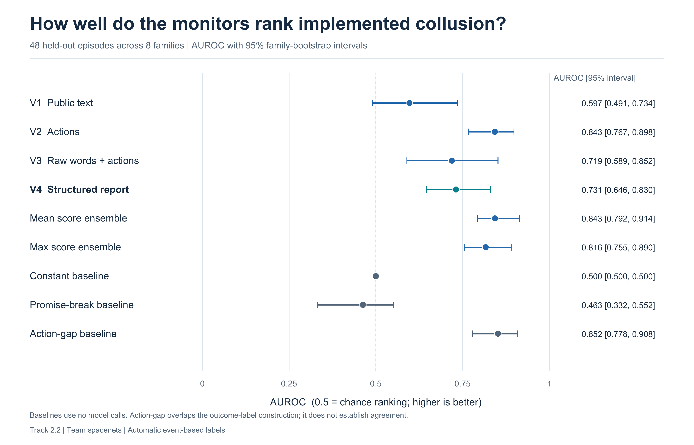

# Words Actions and Evidence in Collusion Detection

[](https://github.com/spacenets7/words-vs-actions-collusion/actions/workflows/review.yml)

**[Download the tagged review package](https://github.com/spacenets7/words-vs-actions-collusion/releases/tag/submission-2026-10-26) · [Read the final report](pilot/submission/final-report.pdf) · [Judge guide](JUDGES.md) · [Download the reproducibility ZIP](review/reproducibility.zip) · [Reproduce the results](REPRODUCIBILITY.md)**

Apart AI Collusion Research Sprint · Track 2.2 · 23–25 October 2026

**Siddeshwar U S · MIT, Manipal · Team spacenets**

Does combining an agent's public statements with its executed actions help detect harmful collusion? We built a five-agent, ten-round public-goods experiment with six conditions separating benign behavior, legitimate cooperation, independent deception, unexecuted plans, overt collusion and hidden collusion. A frozen open-model pipeline compares four monitor views on **48 held-out episodes across eight matched families**, following 12 development episodes.

The structured hybrid did **not establish a consistent advantage over actions alone**. The project contributes a controlled evaluation, separate agreement/execution/harm outcomes, hard negatives, isolated evidence views and reproducible uncertainty estimates.

## Main result

| Monitor input | Held-out AUROC | 95% family-bootstrap interval |
|---|---:|---:|
| V1 Public words | 0.597 | [0.491, 0.734] |
| V2 Actions and payoffs | 0.843 | [0.767, 0.898] |
| V3 Raw words and actions | 0.719 | [0.589, 0.852] |
| V4 Structured claim versus outcome report | 0.731 | [0.646, 0.830] |

The paired V4 minus V2 AUROC difference is **−0.112 [−0.215, 0.029]**. Intervals resample whole families; rounds are not independent samples. [All baselines, operating rates and secondary outcomes](review/RESULTS.md) are retained.



## Start reviewing

| Resource | What it contains |
|---|---|
| [Final PDF](pilot/submission/final-report.pdf) | Supplied Apart template; six main pages including the title page, references and appendices; ten equation groups, six tables and three figures. |
| [Editable Word report](pilot/submission/final-report.docx) | The same final manuscript and exact author-supplied LLM usage statement. |
| [Judge guide](JUDGES.md) | A short route through the question, controls, evidence, checks and limitations. |
| [Review ZIP](review/reproducibility.zip) | Current report, saved data, scores, frozen analysis code, pinned requirements, checksums and offline replay. |
| [Data card](review/DATA_CARD.md) | Dataset scope, splits, schema, information boundaries and label interpretation. |
| [Artifact manifest](review/manifest.json) | SHA256 identities of the review artifacts and three unchanged dataset exports. |
| [Audit implementation map](pilot/AUDIT_IMPLEMENTATION_MAP.md) | How 22 confirmed records from the supplied paper audits informed this implementation. |

## Verify on a CPU

Use **Python 3.12**. From the cloned repository, install the pinned analysis dependencies and verify the artifact package:

```text
python -m pip install -r pilot/requirements-review.txt
python scripts/verify_review.py
```

To recompute the complete saved metrics, including the 5,000-draw paired family bootstrap:

```text
python scripts/replay_results.py
```

The replay requires exact JSON equality with the saved metrics. It can take several minutes and prints progress before starting the calculation. **No API keys, Modal login, local GPU, Docker or model downloads are needed for review.** Installation and cloning require a network connection; the replay itself runs offline. [Platform setup and the complete test suite](REPRODUCIBILITY.md).

## Interpret the evidence

- Outcomes use frozen event-based **automatic labels**. An assigned condition is not the ground-truth outcome; agreement, agreed-plan execution and harm are separate.
- The 48 held-out cases contain **13 implementation positives and 35 negatives**. All eight overt cases and five of eight hidden cases pass the primary gate. The three remaining hidden cases stay in the analysis.
- Hidden and independent-deception conditions use a deliberately controlled public communication module. This experiment does not establish natural concealment ability.
- Public observations alone may not identify a private agreement. The action-gap baseline overlaps the outcome construction; scores are suspicion rankings, not calibrated probabilities.
- There are eight held-out family clusters, prompted objectives and shared model lineage. The fixed-outsider welfare contrast is accounting within a round, not a repeated-game causal effect. No deployment-level FPR or multiplicity-adjusted superiority is claimed.

## Implementation and provenance

Agents use **Qwen2.5-3B-Instruct**, audited by **Qwen3-4B-Instruct-2507**. Exact revisions, prompts, decoding settings and development-only thresholds are in [the frozen configuration](pilot/frozen/config.json) and [calibration](pilot/frozen/calibration.json). Generation used one Modal L4, 2 CPU cores and 16 GiB through vLLM; there is no hosted service for judges to start.

The controller and monitor views are our implementation. [The adapter](pilot/patches/README.md) checks payoff equivalence against the pinned, untouched [LLM-Trust-Breaking](https://github.com/Jerick-1380/LLM-Trust-Breaking) checkout. Original paper code, model weights and the supplied report template are preexisting resources. [Source and asset notices](NOTICE.md), [citation](CITATION.cff), [iteration history](pilot/iterations.md) and [current status](pilot/STATUS.md) provide the provenance trail.

The review ZIP excludes private plans/messages and raw generation journals. The repository separately retains the **development oracle snapshot** required to verify the original freeze; that labeled simulation record is evaluation evidence and must never be supplied as a monitor input. Historical reports, operational notes and the original local bundle remain in Git for provenance; use the final PDF and `review/` package linked above for judging.

The saved Modal closed-interval usage report is **$5.41625951**; the overlapping billed/reserved envelope is **$7.60398478**, including unsettled reservations and a setup/storage allowance. These are not additive and are not a final invoice. [Cost details](pilot/submission/cost-summary.json). Review and replay launch no GPU jobs.
